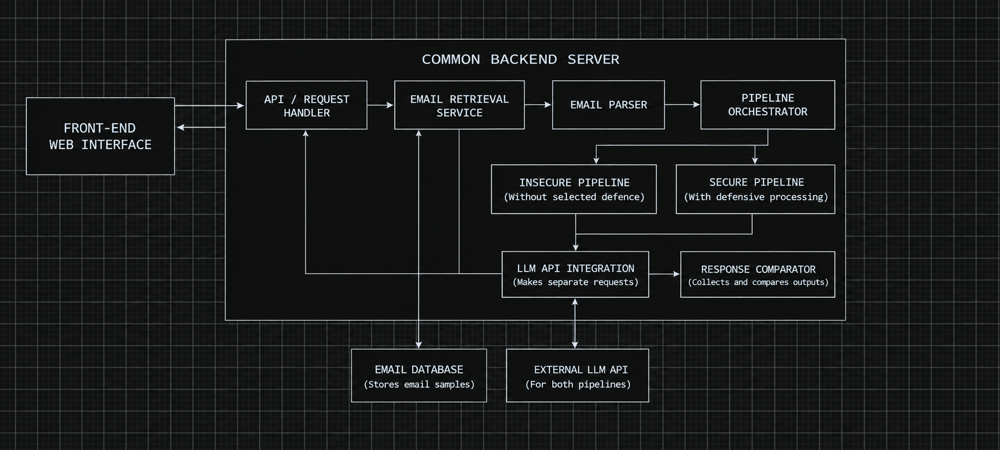
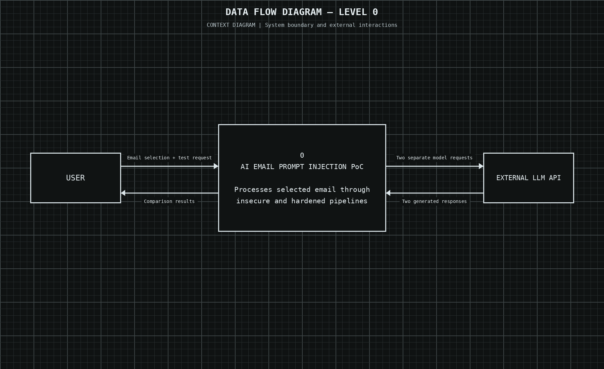
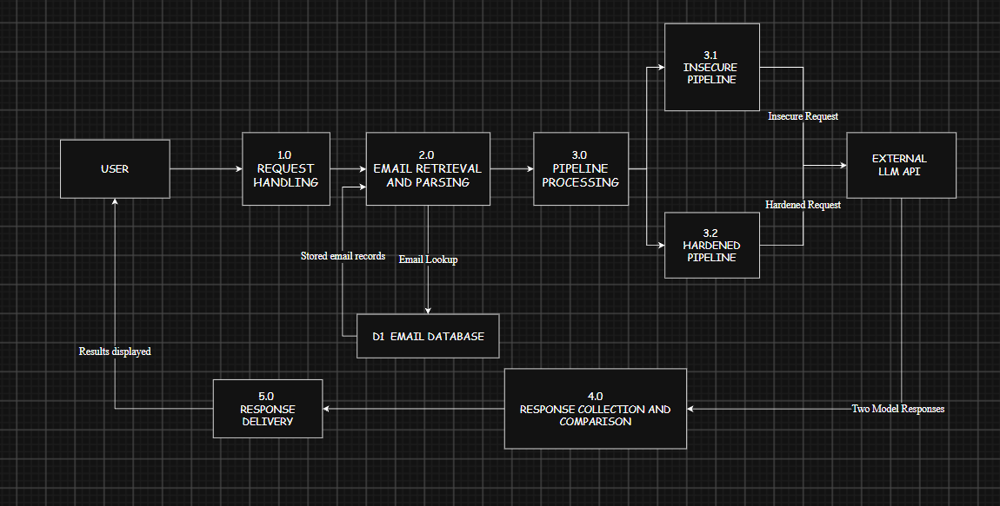
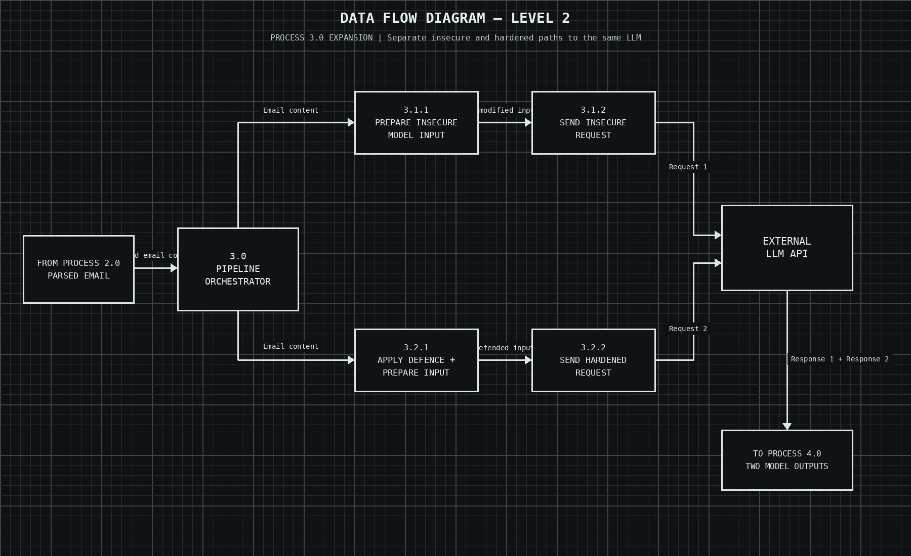

# High-Level Design 

### Project Overview 
Indirect prompt injection is a widening threat to AI-managed systems. Prompts can be injected through an external source such as email and trick the AI model managing the system to reveal important information or even stop following its previous instructions. This project demonstrates how an AI model can change its behaviour if provided with an phishing email containing a malicious prompt hidden in it. 

### Objectives and Scope 
The objective of the project is to create a project that is capable of demonstrating indirect injection with the help of a phishing email. 
Additionally, the project will demonstrate the difference in the behaviour of AI models when working under a secure and insecure processing pipeline. 
**Included:** Controlled, pre-seeded email samples, AI processing through an insecure and a hardened pipeline, output comparison, a basic read-only web interface, and deployment.
**Excluded:** Production email security, integration with real business inboxes, public (user-submitted) email ingestion, and prevention guarantees.

### System Architecture 
The components of the system are:
1. Frontend: a read-only web interface where users select a predefined email and run the comparison.
2. Backend: provides the following services:
   1. API/request handling, with rate limiting
   2. Email retrieval from storage (read-only on the public path)
   3. Email parsing
   4. Insecure and hardened pipelines
   5. API calls to the LLM
   6. Response comparison
   7. Response generation for the web interface
3. Email storage: D1 for email records and results, KV for the visible text and the full raw content of each email.
4. Seeding path (offline, operator-triggered): Cloudflare Email Routing and an Email Worker receive the six test emails, parse the MIME and write them to storage. This path is not exposed to public users.
5. External LLM API: analyses the emails passed through both pipelines.

Security boundary: public users can only select from stored emails. No user-supplied content reaches the parser or the LLM.

### Technology Stack 
| # | Layer | Technology | Purpose in the system | Source |
|---|---|---|---|---|
| 1 | Email ingress (seeding only)  | Cloudflare Email Routing (catch-all on a throwaway domain) | Receives the six synthetic test emails sent by the operator; not open to public use | Stage 3 |
| 2 | Email seeding/ processing | Cloudflare Email Worker (Python) with Python's standard `email` library | Parses raw MIME; separates visible text from full raw content (HTML comments, hidden CSS, base64, zero-width characters) | Stage 3 |
| 3 | Backend / API | Cloudflare Workers, Python + FastAPI + Pydantic | Vulnerable pipeline, hardened pipeline, `/llm-test`, dashboard API | Tech stack table |
| 4 | Database | Cloudflare D1 (binding `prompt_injection_db`) | Email records, vulnerable output, hardened output, manipulation flags | Tech stack table |
| 5 | Key-value store | Cloudflare KV | Stores the visible text and the full raw content of each email | Stage 3 |
| 6 | Dashboard | Cloudflare Pages (HTML, CSS, JavaScript) | Table of email → vulnerable output → hardened output, with visual flags | Stages 2–3 |
| 7 | AI integration | OpenAI API (Claude as an alternative), one model and one system prompt for both pipelines | LLM inference for the two pipelines | Tech stack table, Stage 2 |
| 8 | Secrets | Cloudflare Worker secrets | Holds the API key, never in code, logs or Git | Stage 4 requirements |
| 9 | Dependency management | uv | Reproducible Python environment | Tech stack table |
| 10 | Containerization | Docker (to evaluate, local development only) | Reproducible local environment, not part of the Cloudflare deployment | Tech stack table |
| 11 | Source control | GitHub | Code, documents, test reports, releases | Stages 1–5 |
| 12 | IDE | Visual Studio Code | Development | Tech stack table |
| 13 | Design tools | draw.io, Claude/GPT | HLD, diagrams, test plan | Stage 2 |
| 14 | Deployment | Ansible + Wrangler | Repeatable deployment of the release package to the Cloudflare instance | Stage 4 |
| 15 | Test tooling | Email generators / scripts (to send emails #1–#6) | Drives the tests against the running system | Stage 5 |

### Data Flow 

#### Level 0

#### Level 1

**Note**: Emails enter storage only through the operator-controlled seeding flow. The public user path (1.0 → 2.0 → 3.0 → 4.0 → 5.0) reads from storage and never writes email content.

#### Level 2

